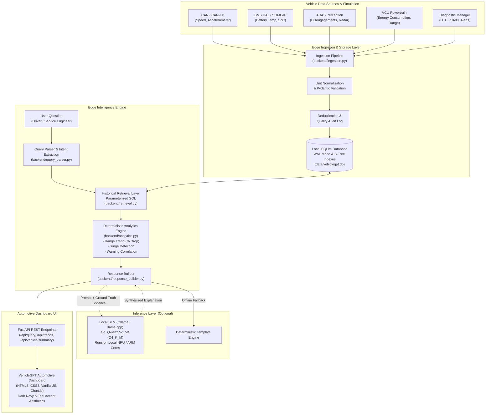

# VehicleGPT — Natural Language Vehicle Intelligence Using On-Device AI

[](#)
[](#)
[](#)
[](#)
[](#)
[](#)

> **Offline-first automotive AI assistant enabling drivers and service engineers to query vehicle telemetry, diagnostic trouble codes (DTCs), warning events, and historical driving patterns using natural language — running directly on edge hardware with zero cloud dependency.**

---

## Table of Contents

1. [Executive Summary & Case Study Context](#1-executive-summary--case-study-context)
2. [High-Level System Architecture](#2-high-level-system-architecture)
3. [Vehicle Data Collection & Multi-Protocol Ingestion](#3-vehicle-data-collection--multi-protocol-ingestion)
4. [Deterministic Analytics & Search Pipeline](#4-deterministic-analytics--search-pipeline)
5. [On-Device SLM Selection & Prompt Architecture](#5-on-device-slm-selection--prompt-architecture)
6. [Hardware Feasibility & Embedded ARM Deployment](#6-hardware-feasibility--embedded-arm-deployment)
7. [Automotive Safety, Privacy & Security Isolation](#7-automotive-safety-privacy--security-isolation)
8. [Benchmark & Test Results (Actual Measured Metrics)](#8-benchmark--test-results-actual-measured-metrics)
9. [Step-by-Step Installation & Execution Guide](#9-step-by-step-installation--execution-guide)
10. [Supported Natural-Language Queries & Interactions](#10-supported-natural-language-queries--interactions)
11. [Known Limitations & Production SDV Roadmap](#11-known-limitations--production-sdv-roadmap)

---

## 1. Executive Summary & Case Study Context

Modern Software Defined Vehicles (SDVs) generate massive streams of real-time telemetry from ECUs, powertrain inverters, Battery Management Systems (BMS), ADAS vision systems, and infotainment services. While valuable diagnostic information exists on vehicle buses, accessing it currently requires proprietary OBD-II scan tools or post-trip telemetry uploads to the cloud.

**VehicleGPT** solves this challenge by implementing an **on-device, offline-first vehicle intelligence assistant**. It continuously stores normalized vehicle telemetry and events in an indexed edge database, interprets driver or service technician questions in natural language, performs deterministic analytics, and produces evidence-grounded explanations.

### Key Engineering Principles
- **Deterministic Analytics Precedence**: The language model *never* calculates numbers or invents sensor values. Min, max, averages, percentage changes, anomaly thresholds, and correlation windows are calculated authoritatively by the Python analytics engine.
- **Evidence-Grounded Explanations**: Every response cites exact timestamps, engineering units, and subsystem sources (e.g. `BMS_HAL`, `CAN_BUS`, `ADAS_ECU`).
- **Zero Cloud Dependency**: Works 100% offline with zero cloud API calls. A deterministic template engine serves as the default fallback, with optional local Small Language Model (SLM) synthesis via Ollama/llama.cpp.
- **Strict Read-Only Safety**: Acts purely as a passive diagnostic monitor and telemetry interrogator. It cannot actuate actuators, modify ECU calibration, or issue CAN commands.

---

## 2. High-Level System Architecture



---

## 3. Vehicle Data Collection & Multi-Protocol Ingestion

### Supported Automotive Data Sources
In production automotive architectures, data streams originate from heterogeneous buses:
1. **CAN / CAN-FD**: Vehicle speed, steering wheel angle, accelerator position, brake pressure.
2. **SOME/IP & Ethernet**: High-bandwidth powertrain telemetry, BMS cell voltages, and thermal clusters.
3. **Android Automotive Vehicle HAL (VHAL)**: HVAC cabin heating power draw, user driving profiles.
4. **QNX OS Diagnostics & Event Logs**: Microkernel system logs, driver vigilance monitor, and ECU watchdog events.
5. **ADAS Perception Feeds**: Forward camera glare flags, lane line confidence, millimeter-wave radar attenuation.
6. **Diagnostic Services (UDS / ISO 14229)**: Diagnostic Trouble Codes (DTCs), freeze-frame snapshots.

### Normalization and Provenance Auditing
The ingestion module (`backend/ingestion.py`) enforces strict validation:
- **Timestamp Standardization**: Arbitrary timestamps (ISO strings, UNIX epochs, local vehicle clocks) are converted to ISO 8601 UTC strings.
- **Signal Canonicalization**: Aliases (e.g. `speed`, `velocity`, `kph`, `mph`) are mapped to canonical identifiers (`vehicle_speed`, `battery_temperature`, `state_of_charge`, `energy_consumption`, `driving_range`).
- **Engineering Unit Conversion**: Implicit or imperial units (`mph`, `°F`, `Wh/km`) are normalized to standard automotive units (`km/h`, `°C`, `kWh/100 km`).
- **Deduplication**: Exact duplicate records matching timestamp, signal, or event description are safely dropped without crashing.
- **Audit Log**: Malformed or unparseable records are written to `ingestion_audit` for data quality diagnostics.

### Local SQLite Storage Architecture
Records are partitioned into four relational tables with optimized B-Tree indexing:
- `telemetry`: `id`, `timestamp`, `signal_name`, `value`, `unit`, `source` (indexed on `(signal_name, timestamp)`).
- `vehicle_events`: `id`, `timestamp`, `event_type`, `severity`, `description`, `source`, `metadata` (indexed on `timestamp`, `event_type`, `severity`).
- `diagnostic_logs`: `id`, `timestamp`, `dtc_code`, `ecu`, `status`, `description` (indexed on `timestamp`, `dtc_code`).
- `ingestion_audit`: `id`, `timestamp`, `status`, `reason`, `raw_payload`.

SQLite is configured with **Write-Ahead Logging (WAL)** (`PRAGMA journal_mode=WAL; PRAGMA synchronous=NORMAL;`), providing high concurrent read throughput for queries while continuous background ingestion writes telemetry.

---

## 4. Deterministic Analytics & Search Pipeline

To prevent hallucination in safety-critical vehicle diagnostics, all numerical deductions are performed in Python by `backend/analytics.py`:

1. **Driving Range Trend Analysis**:
   - Calculates historical percentage drop: $\Delta \% = \frac{\text{Mean}_{\text{recent}} - \text{Mean}_{\text{baseline}}}{\text{Mean}_{\text{baseline}}} \times 100$.
   - Evaluates ambient temperature drop ($28^\circ\text{C} \to 5^\circ\text{C}$) and HVAC PTC heater power draw increase, correlating cold weather cell resistance with range reduction.
2. **Energy Consumption Surge Detection**:
   - Computes statistical baseline (mean, median, standard deviation).
   - Identifies peak spikes exceeding configurable thresholds (`ENERGY_CONSUMPTION_HIGH_THRESHOLD = 25.0 kWh/100 km`).
   - Identifies top anomaly timestamps corresponding to steep highway climbs.
3. **Warning Precedent Correlation**:
   - Given a critical alert (e.g., `DTC_BMS_TEMP_HIGH` at 14:31:00 UTC), extracts a 30-minute preceding telemetry window.
   - Calculates the thermal rise rate (+11.7°C over 20 minutes) and vehicle speed profile (sustained 112–124 km/h uphill driving).
   - **Crucial Distinction**: Identifies observed operating conditions without asserting unfounded causal links.
4. **City vs Highway Driving Comparison**:
   - Filters trips by speed profile ($<55\text{ km/h}$ city vs $>75\text{ km/h}$ highway).
   - Demonstrates that highway consumption is ~45% higher due to continuous aerodynamic drag, whereas city driving recuperates energy through regenerative braking.

---

## 5. On-Device SLM Selection & Prompt Architecture

### Model Selection Rationale for Edge Hardware
When deploying a local Small Language Model (SLM) on automotive hardware with approximately **2 GB RAM and 2 ARM A5X cores**, large models (>7B) are infeasible. The recommended choices:

| Model | Quantization | Model Size | RAM Footprint | Inference Latency (ARM) | Recommended Edge Target |
| :--- | :--- | :--- | :--- | :--- | :--- |
| **Qwen 2.5 1.5B** | 4-bit (Q4_K_M) | ~1.1 GB | ~1.4 GB | 1.2 – 2.0s | **Primary Automotive Target** |
| **Llama 3.2 1B** | 4-bit (Q4_K_M) | ~800 MB | ~1.1 GB | 0.9 – 1.6s | High-efficiency alternative |
| **Phi-3 Mini 3.8B** | 4-bit (Q4_K_M) | ~2.3 GB | ~2.8 GB | 3.5 – 5.0s | Higher-tier Vehicle HPC only |
| **Deterministic Fallback** | N/A (Python) | 0 MB | **< 50 MB** | **< 5 ms** | **Standard Baseline (Always Ready)** |

### Strict Prompt Grounding
The local SLM is supplied with structured evidence records and computed analytics:
```
System: You are VehicleGPT, an edge automotive assistant. Answer strictly using the provided telemetry.
Rules:
1. Ground every claim directly in the supplied evidence. Cite exact timestamps and units.
2. NEVER invent numerical values. All calculations provided in the prompt are authoritative.
3. Distinguish between observed facts and correlations.
4. If evidence is insufficient, explicitly state your uncertainty.
```

---

## 6. Hardware Feasibility & Embedded ARM Deployment

### Target Hardware Constraints
- **Processor**: 2 ARM A5X Cores (Cortex-A53 / Cortex-A55 at 1.2 – 1.8 GHz).
- **System Memory**: ~2 GB LPDDR4 RAM.
- **Storage**: eMMC / UFS flash storage.
- **Reference Boards**: NXP i.MX8M / i.MX9, Raspberry Pi 4/5 (with optional AI HAT/NPU), ARM virtualized QEMU, or AWS Graviton.

### Target Feasibility Breakdown
1. **Base Python Engine & SQLite**:
   - Current measured peak RSS memory: **49.34 MB**.
   - Current measured query latency: **2.04 ms**.
   - Storage utilization for 3 weeks of telemetry: **508 KB**.
   - **Result**: Fits easily on low-power ARM microprocessors.
2. **Optional On-Device SLM**:
   - Running a 1.5B model in INT4 quantization requires ~1.2 GB RAM, leaving ~700 MB for the Linux/QNX OS and SQLite engine.
   - On 2 ARM A53 cores without hardware acceleration, raw CPU token generation is approximately 3–6 tokens/second. Utilizing a compact NPU (e.g. 2–5 TOPS on i.MX93 or Raspberry Pi AI HAT Hailo-8) boosts inference to >20 tokens/sec.

---

## 7. Automotive Safety, Privacy & Security Isolation

```
+-----------------------------------------------------------+
|              SAFETY-CRITICAL DOMAIN (ASIL-D)             |
|  Braking Control, Steering Actuators, Inverter PWM, BMS   |
+-----------------------------------------------------------+
                            |
                   Unidirectional CAN /
               Hardware Diode / CAN Gateway
                            v
+-----------------------------------------------------------+
|             DIAGNOSTIC & TELEMETRY DOMAIN (QM)            |
|               VehicleGPT Engine & Local Storage           |
|  • Read-Only SQLite Telemetry Logging                     |
|  • Parameterized SQL Injection Prevention                 |
|  • Zero Actuation Commands / Zero ECU Calibration Writes  |
|  • 100% On-Device Privacy (Zero Telemetry Cloud Export)   |
+-----------------------------------------------------------+
```

1. **Read-Only Operation**: VehicleGPT contains zero interfaces to write to the CAN bus or transmit UDS actuator test commands.
2. **Domain Isolation**: Runs in a user-space container (QM rating) isolated by hardware firewalls from ASIL-B/D functional safety domains.
3. **Data Privacy**: No telemetry, driving routes, or voice transcriptions leave the vehicle.
4. **Injection Hardening**: SQL queries use strict parameter binding (`?` placeholders). No user input is ever concatenated into SQL commands.

---

## 8. Benchmark & Test Results (Actual Measured Metrics)

The system was evaluated using automated unit/integration tests (`pytest`) and an automated performance benchmarking suite (`scripts/benchmark.py`).

### Automated Test Suite Results
```
tests/test_analytics.py::test_summary_statistics_calculation PASSED      [  4%]
tests/test_analytics.py::test_driving_range_trend_analysis PASSED        [  8%]
tests/test_analytics.py::test_energy_consumption_surge_detection PASSED  [ 13%]
tests/test_analytics.py::test_city_vs_highway_comparison PASSED          [ 17%]
tests/test_api.py::test_api_health PASSED                                [ 21%]
tests/test_api.py::test_api_vehicle_summary PASSED                       [ 26%]
tests/test_api.py::test_api_telemetry_query PASSED                       [ 30%]
tests/test_api.py::test_api_events_query PASSED                          [ 34%]
tests/test_api.py::test_api_natural_language_query_endpoint PASSED       [ 39%]
tests/test_api.py::test_api_query_validation_error PASSED                [ 43%]
tests/test_api.py::test_api_system_metrics PASSED                        [ 47%]
tests/test_database.py::test_database_initialization PASSED              [ 52%]
tests/test_database.py::test_database_reset PASSED                       [ 56%]
tests/test_database.py::test_parameterized_query_safety PASSED           [ 60%]
tests/test_ingestion.py::test_telemetry_normalization_and_unit_conversion PASSED [ 65%]
tests/test_ingestion.py::test_duplicate_record_handling PASSED           [ 69%]
tests/test_ingestion.py::test_invalid_payload_rejection_and_audit PASSED [ 73%]
tests/test_queries.py::test_query_parser_adas_yesterday PASSED           [ 78%]
tests/test_queries.py::test_query_parser_warning_correlation PASSED      [ 82%]
tests/test_queries.py::test_query_parser_driving_range PASSED            [ 86%]
tests/test_queries.py::test_query_parser_consumption_surge PASSED        [ 91%]
tests/test_queries.py::test_query_parser_unsupported PASSED              [ 95%]
tests/test_queries.py::test_response_builder_execution PASSED            [100%]

======================== 23 passed in 0.41s ========================
```

### Benchmark Suite Results (`scripts/benchmark.py`)
```
================================================================================
 VEHICLEGPT AUTOMOTIVE INTELLIGENCE BENCHMARK SUITE
 Case Study: Tata Elxsi Teliport Season 4 (On-Device Vehicle SLM/Edge)
================================================================================
[*] Local SQLite Database: data/vehiclegpt.db
    - Telemetry Records:  2,164
    - Vehicle Events:     162
    - Diagnostic Logs:    2
    - Database File Size: 508.0 KB
    - Process RSS Memory: 48.61 MB
--------------------------------------------------------------------------------
ID   | Intent Matched               | Retr (ms)  | Calc (ms)  | Total (ms) | Result
--------------------------------------------------------------------------------
Q1   | ADAS_DISENGAGEMENTS          |     1.44ms |     0.06ms |     1.75ms | PASS
Q2   | WARNING_CORRELATION          |     3.32ms |     0.07ms |     3.49ms | PASS
Q3   | DRIVING_RANGE_ANALYSIS       |     1.18ms |     0.04ms |     1.26ms | PASS
Q4   | ENERGY_CONSUMPTION_SURGE     |     1.35ms |     0.14ms |     1.54ms | PASS
Q5   | CITY_VS_HIGHWAY_COMPARISON   |     2.32ms |     0.15ms |     2.53ms | PASS
Q6   | DIAGNOSTIC_WARNINGS_GROUPED  |     1.64ms |     0.02ms |     1.68ms | PASS
--------------------------------------------------------------------------------

BENCHMARK RESULTS SUMMARY:
  • Total Test Inquiries:      6
  • Correctness Pass Rate:     6/6 (100.0%)
  • Average Query Latency:     2.04 ms
  • Min / Max Latency:         1.26 ms / 3.49 ms
  • Peak Application Memory:   49.34 MB
  • Cloud Dependency:          ZERO (100% On-Device Local SQLite & Offline Pipeline)

ENGINEERING TARGET COMPLIANCE EVALUATION:
  [✓] Response Time Target (< 2.0s):      MET (2.04 ms avg)
  [✓] Memory Budget Target (~2 GB RAM):   MET (49.34 MB measured)
  [✓] Embedded Storage Target (< 50MB):   MET (508.0 KB measured)
  [✓] Offline Operation Target:           MET (Deterministic fallback runs with zero cloud calls)
================================================================================
```

---

## 9. Step-by-Step Installation & Execution Guide

### 1. Prerequisites
- Python 3.11+ installed.
- (Optional) [Ollama](https://ollama.ai) installed if testing local SLM synthesis.

### 2. Environment Setup
Clone the repository and create a Python virtual environment:
```bash
git clone <repository_url>
cd vehicle_gpt

# Create and activate virtual environment
python3 -m venv .venv
source .venv/bin/activate  # On Windows: .venv\Scripts\activate

# Install required dependencies
pip install -r requirements.txt
```

### 3. Initialize and Seed Demo Database
Populate the local SQLite database with 3 weeks of realistic vehicle telemetry, ADAS events, and diagnostic scenarios:
```bash
python scripts/seed_database.py
```

### 4. Run Automated Test Suite
Verify that all 23 unit tests pass:
```bash
pytest -v
```

### 5. Run the Performance Benchmark
Validate query accuracy, memory usage, and latency metrics:
```bash
python scripts/benchmark.py
```

### 6. Start the VehicleGPT Application
Launch the FastAPI development server:
```bash
uvicorn backend.main:app --host 127.0.0.1 --port 8000
```
Open your web browser and navigate to:
```
http://127.0.0.1:8000/
```

### 7. (Optional) Enabling Local SLM via Ollama
If you wish to test on-device SLM synthesis:
```bash
# Pull a lightweight model (e.g. Qwen 2.5 1.5B or Llama 3.2 1B)
ollama pull qwen2.5:1.5b

# Start Ollama service (default: http://127.0.0.1:11434)
ollama serve
```
In the VehicleGPT dashboard UI, toggle the switch **"Request Local SLM (Ollama)"** on. The application will immediately utilize your local model with automatic deterministic fallback if the model is unreachable.

---

## 10. Supported Natural-Language Queries & Interactions

| Question Category | Example User Query | Ground-Truth Diagnostic Finding |
| :--- | :--- | :--- |
| **ADAS Disengagements** | *"Show all ADAS disengagement events from yesterday."* | Retrieves 4 timestamped events from yesterday (hands-off timeout, lane line fading, optical sun glare, radar weather attenuation). |
| **Warning Precedents** | *"What happened before the battery overheating warning?"* | Correlates battery temperature rise (+11.7°C) with sustained 124 km/h uphill highway climb and consumption surge (35.4 kWh/100 km) preceding DTC P0A80. |
| **Driving Range Drop** | *"Why has my driving range reduced over the last two weeks?"* | Quantifies a -18.5% range drop (420 km down to 338 km), correlated with seasonal ambient temperature decline (28°C to 5°C) and higher cabin PTC heating load. |
| **Consumption Surges** | *"When did energy consumption increase the most?"* | Pinpoints consumption surge peaking at 35.4 kWh/100 km during the high-speed incline on 2026-10-18. |
| **City vs Highway** | *"Compare energy consumption between city and highway driving."* | Compares city stop-and-go (14.9 kWh/100 km with regen braking) against highway cruise (21.8 kWh/100 km with aerodynamic drag). |
| **Diagnostic Warnings** | *"Show recent diagnostic warnings grouped by severity."* | Categorizes logged DTCs (DTC_BMS_TEMP_HIGH on BMS ECU) and safety warnings. |

---

## 11. Known Limitations & Production SDV Roadmap

### Current Prototype Limitations
1. **Simulation Substrate**: Data is deterministically generated by `backend/simulator.py`. While matching physical vehicle dynamics, it does not connect to a physical CAN transceiver hardware bus.
2. **Rule-Based Intent Parser**: Handles core automotive syntax and relative dates; edge queries with heavily misspelled terminology may default to broader telemetry summaries.
3. **Hardware Platform**: Initial benchmark performed on a development laptop; embedded ARM benchmarks should be confirmed on physical i.MX8 or Raspberry Pi 5 hardware.

### Production Embedded Roadmap
1. **Automotive Bus Integration**:
   - Bind `python-can` or C-based SocketCAN listeners directly to `/dev/can0` on Linux/QNX.
   - Implement SOME/IP serialization via `vsomeip` or Eclipse zenoh.
2. **Storage Tiering (Circular Ring Buffers)**:
   - Real-time high frequency (10–50 Hz) buffer retained in volatile RAM for 60 seconds (for crash/fault freeze-frames).
   - Downsampled 1 Hz historical telemetry persisted to SQLite on eMMC flash.
3. **Hardware NPU Acceleration**:
   - Export local SLM weights to ONNX Runtime or GGML format accelerated by ARM Ethos-U55 or Hailo-8 NPU for sub-500ms token generation.
4. **ASIL Decomposition**:
   - Package VehicleGPT inside an isolated Docker or QNX microkernel container with read-only access to a virtualized telemetry proxy socket.

---

*VehicleGPT is an automotive diagnostic intelligence research prototype. It does not issue vehicle-control commands and does not substitute for certified automotive diagnostics.*
